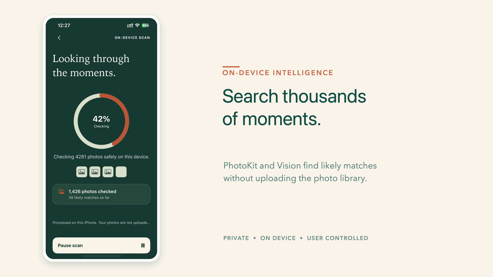
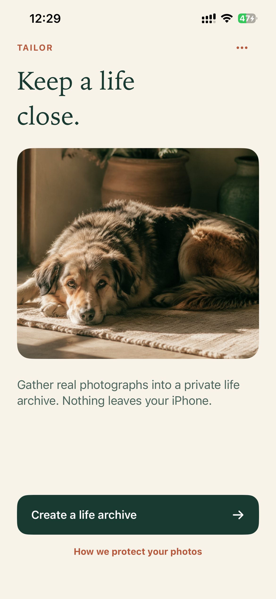
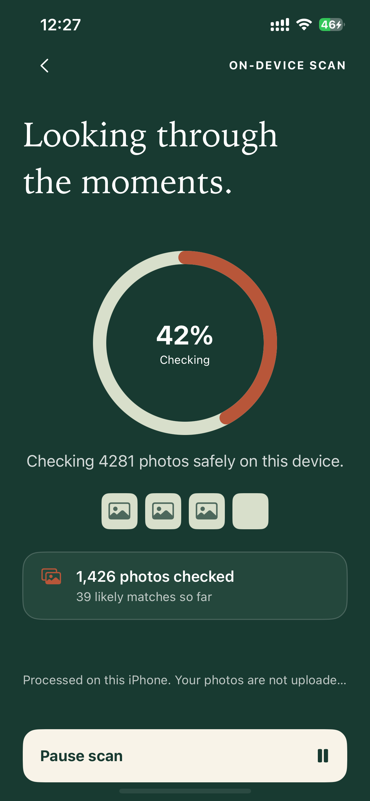
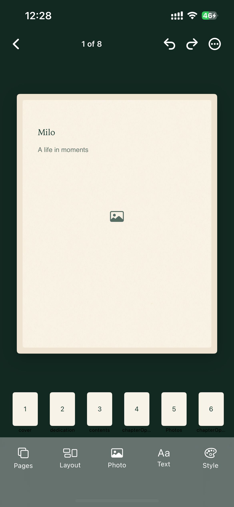
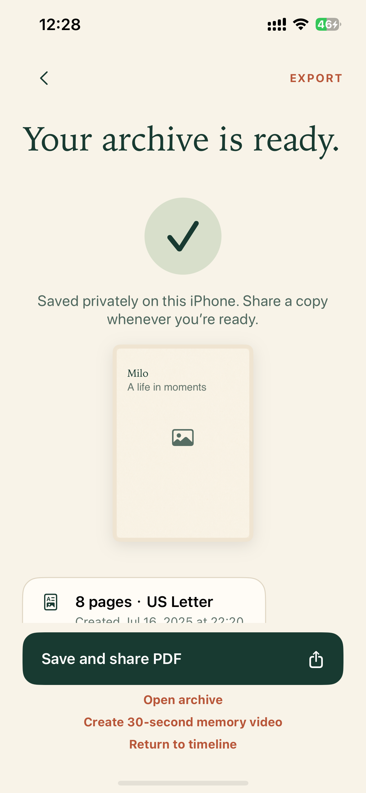

# Tailor

**A private, on-device iOS app that turns a pet owner's photo library into a meaningful life archive.**

Tailor helps people rediscover photographs of a beloved pet, review suggested matches, arrange them into a timeline, edit a memory book, and export the finished story as a PDF or short video. Photo analysis and archive storage remain on the iPhone.

<p align="center">
  
</p>

## Why Tailor

The photographs that define a pet's life are often scattered across thousands of ordinary camera-roll moments. Organizing them manually can be time-consuming and emotionally difficult. Tailor was inspired by a simple question: can on-device intelligence make this work gentler without taking ownership or control away from the user?

Privacy is therefore a product requirement, not a marketing layer. Tailor does not require a photo-upload service. Automated recognition only proposes candidates; people make the final decisions about what belongs, what is sensitive, and what should never be used.

## Product journey

1. Explain privacy and request only the photo access the user chooses.
2. Create a pet profile and select several reference photographs.
3. Scan the approved library locally with PhotoKit and Vision.
4. Review high-confidence, uncertain, excluded, and sensitive candidates.
5. Turn confirmed moments into chronological chapters.
6. Edit page layouts, text, photo selection, crop, rotation, and style.
7. Preview the book and export a print-ready PDF or memory video.
8. Reopen the saved archive without rescanning the full library.

<table>
  <tr>
    <td></td>
    <td></td>
    <td></td>
    <td></td>
  </tr>
</table>

## Built with

- Swift and SwiftUI
- PhotoKit for user-controlled library access
- Apple Vision for animal detection and feature-print similarity
- SwiftData for profiles, decisions, scan checkpoints, books, and export records
- StoreKit 2 for the one-time album unlock
- Core Graphics for deterministic PDF rendering
- AVFoundation for local video export
- XCTest and XCUITest for model, service, UI, and visual-regression coverage
- Swift Concurrency for resumable scanning and export work

The app targets iOS 17 or later and intentionally has no third-party runtime dependencies.

## Architecture

Tailor separates platform integrations from product state through service protocols:

```text
SwiftUI features
      ↓
MilestoneRootView + domain state
      ↓
ArchiveRepository · PetScanServicing · PurchaseServicing
PDFExporting · VideoExporting
      ↓
SwiftData · PhotoKit/Vision · StoreKit 2 · Core Graphics · AVFoundation
```

The memory book uses a shared data path:

```text
MemoryBookDocument → MemoryBookPage → MemoryBookElement
                              ↓
                    MemoryBookPageRenderPlan
                     ↙        ↓        ↘
                  Editor    Reader     PDF
```

Editor, Reader, Book Check, and PDF export consume the same page, typography, and crop contracts. Export creates an immutable snapshot so edits made during rendering only affect the next export.

## Privacy and safety choices

- Photo matching happens locally on the iPhone.
- Limited Photos access is supported; full-library access is not required.
- Low-confidence matches require review and are never selected silently.
- Sensitive and “never use” decisions remain excluded downstream.
- Scanning pauses when the app backgrounds and resumes from a saved checkpoint.
- Deleting a Tailor archive does not delete photographs from Apple Photos.
- UI automation runs with isolated deterministic fixtures, never personal photo data.

## How Codex and GPT-5.6 were used

Codex with GPT-5.6 served as a collaborative engineering and product agent throughout the build. It was used for:

- **Product synthesis:** converting the project idea into a traceable PRD, open-question log, release gates, and acceptance criteria.
- **Architecture:** shaping protocol-based services, production/demo composition, resumable scan checkpoints, the memory-book document model, and shared rendering contracts.
- **Implementation:** pairing on SwiftUI screens, PhotoKit/Vision scanning, SwiftData persistence, StoreKit states, editor transactions, crop geometry, text layout, PDF rendering, and video export.
- **Testing:** generating and running model tests and XCUITests, creating deterministic launch fixtures, reviewing failures, and producing visual-regression evidence.
- **Real-device work:** pairing an iPhone with Xcode, building and installing the signed app, launching deterministic routes, and collecting publication-safe screenshots.
- **Project storytelling:** drafting the project story, preparing gallery captions, and producing the 60-second promotional video from verified real-device captures.

GPT-5.6 did not autonomously make private-photo decisions or release the product. Human review remained responsible for product intent, privacy boundaries, visual approval, device permissions, GitHub authorization, and every external publication step. Generated code and claims were checked through builds, tests, source inspection, or real-device evidence before being accepted.

## Run locally

Requirements:

- macOS with Xcode 26 or later
- iOS 17+ simulator or device
- An Apple development team for physical-device signing
- Optional: [XcodeGen](https://github.com/yonaskolb/XcodeGen) 2.38+ if regenerating the project from `project.yml`

Open `Tailor.xcodeproj`, select the `Tailor` scheme, choose a simulator or signed device, and run.

For deterministic UI development without Photos or StoreKit:

```text
-uiTesting -uiDemoRoute welcome
-uiTesting -uiDemoRoute scan -uiDemoState running
-uiTesting -uiDemoRoute preview -uiDemoState preview-purchased
```

Normal launches always use the production service container.

## Validation

The project builds successfully for the iOS Simulator and a physical iPhone 13. The test suite covers routing, persistence, recognition policies, scan resume/merge behavior, purchase failure safety, page construction, editor operations, shared rendering, Unicode text, crop geometry, PDF evidence, and the end-to-end archive flow.

The current local verification run passes 78 model/service tests and 44 end-to-end UI tests. Real-library recognition calibration, StoreKit release evidence, privacy-manifest and signed-archive validation, accessibility evidence, and approved Editor/Reader/PDF pixel baselines remain release gates. This repository should not be interpreted as an App Store release candidate; see `docs/release-readiness-audit-2026-07-19.md` for the current gate-by-gate verdict.

## Repository map

```text
Tailor/App             Composition root and routing
Tailor/Domain          Archive and memory-book models/render contracts
Tailor/Features        Onboarding, review, timeline, editor, preview, export
Tailor/Services        PhotoKit/Vision, SwiftData, StoreKit, PDF/video services
TailorTests            Model and service tests
TailorUITests          Deterministic end-to-end and visual UI tests
design                 Product design, prototypes, and visual QA references
docs                   PRD, architecture, release gates, and test plans
```

## Status

Tailor is a functional local Alpha created for Build Week. The core private archive flow runs end to end; release-level recognition calibration and visual/real-device gates are still being completed.
