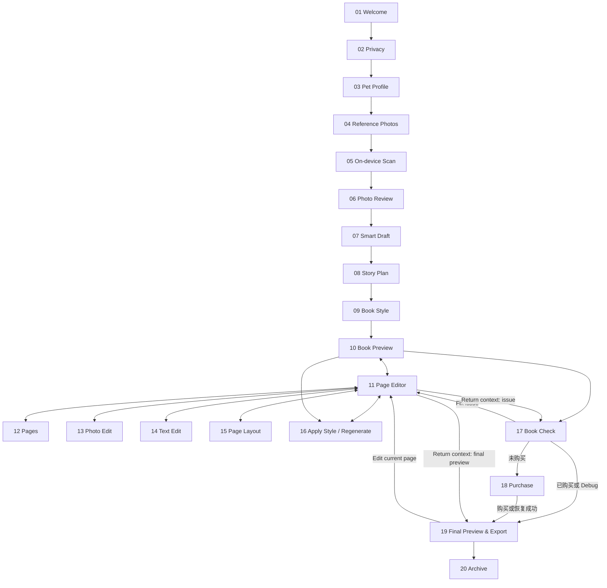

# Tailor v2 原型流程与页面契约

## 1. 主流程图

## 2. 页面跳转合同

| ID | 页面 | 进入来源 | 主操作 | 次操作/返回 | 成功去向 |
| --- | --- | --- | --- | --- | --- |
| 01 | Welcome | 首次启动/无档案 | Create life archive | Privacy details | 02 |
| 02 | Privacy | 01/设置 | Allow Photos | Limited/Manual Import/Back | 03；denied 的 Manual Import 进入 03 后的 04 手动状态 |
| 03 | Pet Profile | 02/新建档案/20恢复 | Continue | Back/Save for later→20 | 04 |
| 04 | Reference Photos / Manual Import | 03/20恢复 | Start finding；手动模式 Review selected photos | Remove/replace/Save for later→20 | 授权模式→05；denied手动模式→06 |
| 05 | On-device Scan | 04/20恢复 | Pause/Resume | Continue later→20/Back | 06 |
| 06 | Photo Review | 05/手动导入/20恢复 | Create memory book | 过滤、批量、查看、Save for later→20 | 07 |
| 07 | Smart Draft | 06/20恢复 | Continue to story | Cancel→06；Continue later→20；Fallback | 08；产出 StoryPlanDraft，不创建页面 |
| 08 | Story Plan | 07/10 Story/20恢复 | 首次 Choose book style；已有文档 Save story changes | 编辑、合并、隐藏、回照片/Save for later→20 | 09（首次）或 10；首次只确认 StoryPlanDraft |
| 09 | Book Style | 08/11 Style/20恢复 | Use template + paper size | Preview template/Save for later→20/Back | 10；首次默认 Letter，可选A4，并原子创建完整 MemoryBookDocument |
| 10 | Book Preview | 09/11 Back/20 | Customize / Check book | Story/Style/Back | 11 或 17 |
| 11 | Page Editor | 10 当前页/17 issue/19 当前页 | 编辑并自动保存 | Preview/Back | 10直接返回；17/19因新revision先自动Book Check，再按结果和稳定locator/fallback返回 |
| 12 | Pages | 11 Pages | 选择/增加/复制/重排 | Close | 11 |
| 13 | Photo Edit | 11 选中图片 | Done | Cancel/Replace/Remove | 11 |
| 14 | Text Edit | 11 选中文字/Text | Apply/Close | Delete/Layer | 11 |
| 15 | Page Layout | 11 Layout | Apply to this page | Cancel | 11 |
| 16 | Apply Style / Regenerate | 10/11 Style/More | Apply confirmed diff | Cancel | 10来源返回10；11来源只弹出临时帧并返回11，保留11底层的10/17/19 context stack |
| 17 | Book Check | 10 | Continue | Go to page/Ignore warning | 18 或 19 |
| 18 | Purchase | 仅17当前revision通过态 | Unlock/Restore | Cancel | 成功→19；取消返回17相同通过态；10不得直达18 |
| 19 | Final Preview & Export | 17/18 | Export PDF | A4/Letter（切换后重新Check）/Back to edit | 成功停留19；Done/View in Archive→20 |
| 20 | Archive | 启动/03–09稍后继续/19 | 动态 Continue/Open PDF | Refresh/Delete/Settings | 按 checkpoint→03/04/05/06/07/08/09/10；PDF→系统预览 |

## 3. 页面职责边界

### Story Plan 与 Page Editor

- Story Plan 管理章节语义：日期、标题、说明、代表图、章节顺序、合并、拆分、隐藏。
- Page Editor 管理页面视觉：元素 frame、裁切、旋转、层级、文字样式、页面配方。
- Story Plan 改变照片集合时只标记 `needsReflow`，不直接覆盖锁定页面。
- 合并只允许相邻章节；拆分必须选择照片分割点；排序后持久化 `sortOrder`。每项先显示影响摘要，未锁受影响页显示 `needsReflow`，锁定页显示 `Unchanged`。

### ReturnContext 与 revision

- 使用栈而不是单一 source：`10/17/19 → 11 → 16` 时，16 只返回11，11再消费底层来源。
- 17→11 保存后自动复检；同 ruleID+pageID+elementID 问题仍存在则恢复，消失则取 formerIssueIndex 附近的下一问题，无问题显示通过态。
- 19→11 保存后自动复检；blocking→17，通过→19。logicalPageID 消失时取 formerPageIndex 最近页，均不存在回第1页。
- 复检完成前不得展示旧 Book Check 或旧 Final Preview revision。

### Book Preview 与 Final Preview

- Book Preview 是购买前/编辑中的阅读验证，可进入编辑器；未购买显示 `min(8,totalPageCount)` 页水印样章，正常 8 页、最少 6 页。
- Final Preview 是通过 Book Check 且已解锁后的完整无水印纸张预览，直接对应 PDF。
- `Customize/Edit` 携当前 logicalPageID 进入 Page Editor，返回时恢复同一逻辑页；Book Check 携 issueIndex/pageID/elementID 精确进入元素，返回恢复同一问题位置。

### 字体、Book Check 与价格状态

- 8 个字体 token 必须解析为 UIKit/CoreText 共用的同一 PostScript 名；重建不一致时显示字体阻断，不允许静默换成 Times New Roman。
- 忽略 suggestion 前展示风险确认，确认后显示 `Ignored by you` 和撤销入口；blocking 永远没有忽略入口。
- Purchase 价格使用 StoreKit `displayPrice`；加载中不展示伪价格，加载失败禁用购买并展示 Retry/Restore/Back。
- Book Check 结果绑定 documentRevisionID + paperSize + rulesVersion；09 默认 US Letter、可选 A4，19 切纸型必须创建新 revision 并重新检查。
- Debug bypass 仅存在于显式 UI-test 参数驱动的 DEBUG 编译；Release/TestFlight/App Store 不可达。

### Layout 与 Regenerate

- Layout 只作用当前页，并把该页标记为用户编辑/锁定。
- Regenerate 默认只处理 `needsReflow` 和未锁页面，必须展示影响并可撤销。

## 4. 原型视觉映射

| v2 页面 | 当前视觉来源 |
| --- | --- |
| 01–06 | `design/prototype_v2/v2_pages_01_06_contract.md`（产品/状态基线）+ `design/reference/v1_1`（仅视觉参考） |
| 07 | `design/auto-book-v2/prototype.html?screen=01` |
| 08 | `design/auto-book-v2/prototype.html?screen=02` |
| 09 | `design/auto-book-v2/prototype.html?screen=03` |
| 10 | `design/auto-book-v2/prototype.html?screen=04` |
| 11–14 | `design/editor_v1/prototype.html` |
| 15 | `design/auto-book-v2/prototype.html?screen=05` |
| 16 | `design/auto-book-v2/prototype.html?screen=06` |
| 17 | `design/auto-book-v2/prototype.html?screen=07` |
| 18 | `design/reference/v1_1/10-purchase-default.png` 及失败/取消/恢复状态 |
| 19 | `design/auto-book-v2/prototype.html?screen=08` |
| 20 | `design/reference/v1_1/12-archives-populated.png` 及相关状态 |
