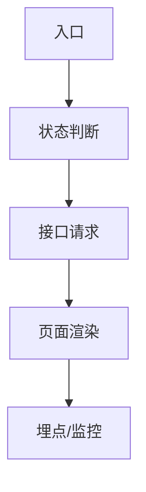

# 03 技术方案

## 方案结论

## 影响范围

| 端 | 模块 | 文件/目录 | 影响说明 |
| --- | --- | --- | --- |
| Android |  |  |  |
| iOS |  |  |  |
| 鸿蒙 |  |  |  |

## 架构和数据流

## 状态模型

| 状态 | 进入条件 | 退出条件 | UI 表现 | 数据要求 |
| --- | --- | --- | --- | --- |

## 接口设计和调用策略

| 接口 | 调用时机 | 成功处理 | 失败处理 | 重试/缓存 |
| --- | --- | --- | --- | --- |

## Android 方案

### 改动点

### 风险

### 测试关注

## iOS 方案

### 改动点

### 风险

### 测试关注

## 鸿蒙方案

### 改动点

### 风险

### 测试关注

## 埋点和监控方案

| 点位 | 端 | 触发条件 | 参数 | 验证方式 |
| --- | --- | --- | --- | --- |

## 烛龙日志和诊断方案

| 日志场景 | 端/服务 | 关键字段 | 检索关键字 | 诊断用途 | 脱敏要求 |
| --- | --- | --- | --- | --- | --- |

## 降级兜底策略

| 失败场景 | 触发条件 | 端侧表现 | 数据处理 | 日志/埋点 | 恢复方式 |
| --- | --- | --- | --- | --- | --- |

## 兼容性

| 维度 | 策略 | 验证方式 |
| --- | --- | --- |

## 灰度和回滚

| 项 | 策略 | 操作人 | 验证 |
| --- | --- | --- | --- |

## 风险清单

| 风险 | 影响 | 规避方案 | 兜底方案 |
| --- | --- | --- | --- |
